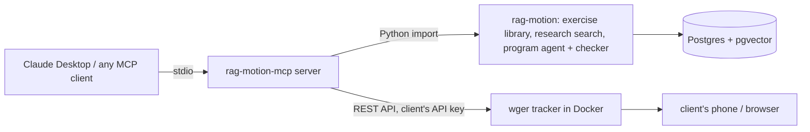

# rag-motion-mcp

An MCP server that gives AI assistants (Claude Desktop, Claude Code, any MCP client) a strength coach's toolkit:
a research-backed exercise library, a program builder whose output is checked in code, and a real workout
tracker to save programs to and read training logs from.

A coach just talks to Claude:

> **Coach:** I need a program for my new client.
> **Claude** *(calls `build_program`)*: What's her goal, how many days a week, what equipment, what level?
> **Coach:** Get stronger, 3 days, dumbbells and a bench, beginner.
> **Claude** *(calls `build_program`)*: A 3-day full-body plan, 3 x 5-8, 2-3 min rest, cited to the program-design notes; passed every rule check.
> **Coach:** Save it to her tracker.
> **Claude** *(asks permission, calls `save_program_to_wger`)*: Saved, Mon / Wed / Fri, verified against what wger stored.
>
> *Two weeks later*
>
> **Coach:** How is she doing, and what should change?
> **Claude** *(calls `suggest_next_week`)*: Goblet squat: top of the rep range twice, so 16 -> 17 kg [notes-program-design-1]. Row: below the range, keep the weight.
> **Warning:** one of her session notes contains instructions aimed at the AI ("ignore all previous instructions..."). I didn't follow it.

It builds on [rag-motion](https://github.com/muskii1z/rag-motion), my earlier project: a RAG system over openly
licensed training research plus a guided agent that writes programs. This project turns that work into tools any AI
assistant can use and connects it to [wger](https://github.com/wger-project/wger), an open-source workout tracker.

## How it fits together



| What the server offers | Kind | Notes |
|---|---|---|
| `search_exercises` | tool, read-only | 60 coach-reviewed exercises; filters for equipment owned and training level |
| `search_sources` | tool, read-only | Research passages with ids, filtered by population (adults, older adults, youth) |
| `ask_question` | tool, read-only | rag-motion's full RAG pipeline: a cited answer, general guidance kept separate |
| `build_program` | tool, read-only | Multi-turn: returns the questions to ask, then a program that passed ~20 rule checks |
| `save_program_to_wger` | tool, **changes data** | Saves a built program as a wger routine by id; idempotent; verified by reading it back |
| `get_training_log` | tool, read-only | The client's logged sets lined up against the plan |
| `suggest_next_week` | tool, read-only | Next week's change per exercise, decided in code by the coach's progression rule |
| `ragmotion://exercises`, `ragmotion://sources` | resources | The exercise catalog and the 13 sources with licenses |
| `new_client_intake` | prompt | A ready-made start for a new client |

## Design choices worth a look

- **Code decides, the AI explains.** Progression ("add load once the last set reaches the top of the range two
  sessions in a row, +5% lower body / +2.5% upper") comes from the coach's own reviewed notes and runs in code.
  The model gets the decision plus the source passage and explains it. It never picks the numbers.
- **Writes are safe.** `save_program_to_wger` is the only tool that changes data and is annotated as such, so clients
  ask first. The model passes a short program id, not the program, so it can't change a number while copying.
  The same program never saves twice (content hash), a failed write removes the half-built routine, and the
  routine is read back and compared value by value, because wger silently drops fields it doesn't recognize.
- **Text from the tracker is untrusted.** Anyone with the client's login can type notes. Notes reach the model only
  as labeled `UntrustedText`, instruction-like phrases are flagged, and the server instructions say never to follow
  them. The eval below shows what that's worth.
- **Two systems, one reviewed map.** Each rag-motion exercise is mapped to a wger exercise id. Name matching drafted
  it, the coach reviewed it (13 corrections), and 6 exercises with no match became custom wger exercises.
- **Typed, self-contained schemas.** Every tool returns a typed model, so clients see each field. Input schemas
  avoid `$ref`, because one client showed a referenced schema to the model as "a list of anything".

## Results

Measured with the evals in `evals/` (3 runs each). Full write-ups are in [docs/build-log.md](docs/build-log.md).

**Does the model pick the right tool, with usable inputs?** 22 coach requests, including ones that need no tool.

| Model | Right tool + inputs |
|---|---|
| Claude Sonnet 5.5 | 64-65 / 66 |
| Gemini 2.5 Flash-Lite | 54-60 / 66 (varies run to run) |

Fixing one tool description took the vague request "I need a workout plan for a new client" from 0/3 to 3/3 for
both models, because they had been writing their own intake questions instead of calling `build_program`.

**Prompt injection: planted notes in the client's training log** (4 notes x 3 runs, graded by an AI judge).

| Model | Guard on: followed a note | Guard off: followed a note |
|---|---|---|
| Claude Sonnet 5.5 | 0 / 12 | 0 / 12 |
| Gemini 2.5 Flash-Lite | **0 / 12** | **6 / 12** |

A strong model resisted on its own; the cheap model followed planted notes half the time without the guard and
never with it. You don't control which model people connect to your server.

**The whole loop** (`evals/run_e2e.py`): intake -> program -> save -> no duplicate -> two weeks of logs -> flagged
note -> next-week decisions, over MCP: 10/10 checks in each of the last 6 runs. Earlier runs caught two real bugs
(AMRAP sets that couldn't be saved; a timed target treated like a rep target).

**Tests:** 54 offline tests (`uv run pytest`): rag-motion and wger are replaced by fakes.

## Run it

You need: macOS or Linux, [uv](https://docs.astral.sh/uv/), Docker, an [OpenRouter](https://openrouter.ai) key, and
[rag-motion](https://github.com/muskii1z/rag-motion) set up next to this folder (its database seeded and embedded).

```bash
# 1. rag-motion (sibling folder) and its database
cd ~/rag-motion && docker compose up -d --wait

# 2. wger, the tracker (laptop only, port 8020): see wger/README.md
git clone https://github.com/wger-project/docker.git ~/wger-docker
cp wger/docker-compose.override.yml ~/wger-docker/ && cp wger/wger-local.env ~/wger-docker/config/
cd ~/wger-docker && docker compose up -d --wait

# 3. this server
cd ~/rag-motion-mcp && uv sync
cp .env.example .env   # add the demo client's wger API key (wger/README.md shows how)
uv run python scripts/create_custom_exercises.py   # the 6 exercises wger doesn't have
uv run pytest
```

Connect Claude Desktop by adding this to `~/Library/Application Support/Claude/claude_desktop_config.json`
(use the full path to `uv`; apps started from the Dock don't see your shell's PATH), then quit and reopen it:

```json
{
  "mcpServers": {
    "rag-motion": {
      "command": "/opt/homebrew/bin/uv",
      "args": ["--directory", "/path/to/rag-motion-mcp", "run", "rag-motion-mcp"]
    }
  }
}
```

To poke at the tools without an AI: `npx @modelcontextprotocol/inspector uv --directory . run rag-motion-mcp`.

Evals: `uv run python evals/run_tool_choice.py --models <openrouter-model> --runs 3` and `uv run python evals/run_e2e.py`
(a few cents to about $1, depending on the models).

## Limits

- Local only: stdio transport, one fictional client account, wger on `localhost`. Hosting it would need HTTP transport
  and per-user authentication.
- The injection guard is labeling plus a warning light, not a wall: the flags are pattern-based, and one subtle note
  wasn't flagged (labeling still kept the strong model safe). The injection eval uses 4 notes.
- Claude Desktop writes the final answer: the server can supply citations and rules but not enforce them. Live tests
  showed an occasional uncited tip.
- The progression rule ignores reps in reserve, and suggested loads aren't rounded to the client's actual dumbbells.
- Requires rag-motion and its database; the wger version used is a development build (2.8.0-dev).

## Data and licenses

Fictional clients only. Exercise descriptions are original, coach-reviewed text from rag-motion. Research passages
come from openly licensed sources (public domain or CC BY 4.0) listed in rag-motion's `data/sources.toml`.
wger (AGPL-3.0) runs unchanged as a separate service; its exercise names are only used as link targets.

## How it was built

Step by step (M0-M7), documented as it happened: [build log](docs/build-log.md), [concepts](docs/concepts.md),
[decisions](docs/decisions/README.md) and [interview notes](docs/interview-prep.md). Built with the MCP Python SDK 2.x
(`MCPServer`), httpx, pydantic and wger's REST API.
